# Runtime generation overlap, standby and graceful retirement

Owner: Aiterm. Adopted BellTeam target: hot adoption without restarting its body or native/vendor processes. This file is the implementation function/DFD contract; caller operation pins and updater selection remain external. Default standalone tools and ordinary startup remain unchanged unless runtime adoption is explicitly configured by the spawning host.

| Function | Source / input -> output | State ownership |
| --- | --- | --- |
| overlap validation | `runtime-compatibility.ts`: signed-archive declaration + effective live/source/provider/recover identities -> supported common formats | no package execution; declaration is bound to signed archive by caller verification; semver alone never proves overlap |
| lifecycle controller | `runtime-adoption.ts`: trusted startup generation/scope/mode + existing job ID -> prepare/activate/status/retire receipt | active request set and retirement in process; durable activation metadata under stateRoot/runtime-adoption/existing-scope/jobId.json |
| MCP request admission | `index.ts`: explicitly configured runtime lifecycle + tools/call -> tracked real handler completion | standby admits lifecycle control only, no generic tool effects or manager recovery; retiring admits no new ordinary requests |
| parent manager ownership | `index.ts` and existing `ParentDeliveryManager.close`: deferred construction until activation; awaited close on retire | preserve existing owner/claim/delivery IDs; no second business queue |
| native entry composition | `execution-native-server.ts`: host runtime mode/generation settings -> configured ordinary/native MCP | existing state/socket/provider scope remains authoritative; default launch has no lifecycle control tool |
| setup/capsule identity | public setup integration helpers: verified installation capsule -> sameRegistration/globalRegistration-compatible descriptor and original owned fields | updater writes immutable capsule; setup remains only serial HOME registration owner |

```mermaid
stateDiagram-v2
  [*] --> Standby: explicit host mode
  [*] --> Active: ordinary/default startup
  Standby --> Active: durable activation written then ACK
  Standby --> Closed: candidate discarded; no production work
  Active --> Retiring: caller no longer routes new operations here
  Retiring --> Retired: real handlers/manager work settle; owner.closed ACK
  Retired --> Closed: SDK closes; native seats remain alive
```

DFD: host's signed candidate decision -> configured lifecycle -> standby prepare. activate(jobId, expected) -> atomic/fsynced metadata -> manager admission -> ACK -> external facade route assignment -> external updater commit. status reads durable metadata without reactivation. Retire tracks actual handler completion, awaits existing manager close and returns ACK before SDK closure; it never invokes core.closeSession/killAll, agent_stop or vendor resume. The control handler itself is excluded from its own drain count.

Implemented interface (source contract for callers):

| Boundary | Exact form |
| --- | --- |
| Host composition | `execution-native-server.js ... --mode mcp --runtime-adoption standby\|active --runtime-generation <token> --runtime-scope <token>`; all three or none, mcp mode only. argv, not env, so spawned seats/hooks never inherit it. Library: `createAitermServer({ runtimeAdoption })` / `createNativeDeliveryServer({ runtimeAdoption })` |
| Control tool | `runtime_adoption` `{action: prepare\|activate\|status\|retire, job_id?, expected?, live?}`; registered only with the composition above; result `structuredContent.schema = aiterm.runtime-adoption.v1`, errors `{error_code}` with `isError` |
| prepare | standby only; `expected` token + `live` = 1..32 declarations or `"legacy-v1"` for every live/recovery generation -> `overlap {supported, common_formats, conflicts}`. Unsupported clears any earlier prepare |
| activate | requires a supported prepare with the same `expected`; writes `<state-root>/runtime-adoption/<scope>/<job_id>.json` via file+directory fsync, THEN admits manager work and ACKs. Same job/expected again -> idempotent ACK (also from a reconstructed `active` process). Different -> `RUNTIME_ADOPTION_CONFLICT` |
| status | read-only: `activated` + record, `absent` only on ENOENT; unreadable/corrupt -> `RUNTIME_ADOPTION_UNAVAILABLE` (never absent) |
| retire | refuses new ordinary tools, awaits tracked real handler completion, awaits the existing ParentDeliveryManager close (owner.closed), ACK `owner_closed: true`; caller closes the SDK afterwards. Same promise on repeat; failure lets a later retire retry |
| Declaration | `runtime-overlap.json` at package root (in npm `files`), schema `aiterm.runtime-overlap.v1`, `manager_abi`, six stores `{writes, reads[]}`. Pre-declaration releases are `"legacy-v1"` (all strict v1 / steer-v1). Pure data: `runtime-compatibility.ts` never executes a package |
| Capsule recognition | `setup-integrations.ts` `sameRegistration` -> `installationCapsuleEntry`: same Node command, absolute `args[0]` basename `index.js` (no args) or `execution-native-server.js` (`--execution-interrupt` first, mode mcp, never `--runtime-adoption`), sibling `aiterm-capsule.json` `{schema: aiterm.installation-capsule.v1, package: aiterm-mcp, entries[]}` listing that basename; also inside `mcp-lazy`. JSON/Codex/Grok readers then keep the entry and its timeout/env. Marker and entry stubs are written by the updater installer (Molly); Claude/Cursor hooks already match by hook basename, Codex hooks match the exact command BellTeam registers |
| Errors | `RUNTIME_ADOPTION_INVALID`, `_STATE`, `_CONFLICT`, `_UNSUPPORTED`, `_UNAVAILABLE`, `_NOT_SERVING` |

## State volume declaration (body replacement preserve/reset)

Ruling 2026-11-09 (Trony, after the fb923ca4 swap reset every saved seat): an Aiterm upgrade keeps the existing state. Version or reader-closure inequality is never a reset reason; the identity-only preserve check is withdrawn. The installer (Molly) decides from the declaration below.

| Item | Contract |
| --- | --- |
| File | `state-compat.json` at package root (npm `files`), plain JSON <= 64 KiB, read with fs + JSON.parse; no package code runs |
| Shape | `{schema: "aiterm.state-compat.v1", stores: {<storeId>: {path, writes, reads[], resets[], legacy[{from, through, format}]}}}`; ids `^[a-z0-9][a-z0-9._-]{0,63}$`; `path` relative to the state volume root (`AITERM_STATE_BASE`), stores never nest |
| `{uid}` | path segment token = the numeric UID of the Aiterm process (state root is `aiterm-mcp-<uid>`, `agent-shared.ts stateRootCandidates`) |
| Store | `state-root` = the whole `aiterm-mcp-{uid}` tree. Format `v1` = every `runtime-overlap.json` store at its v1 / steer-v1 format. `legacy` 0.63.17-0.67.0 = v1 (those releases' runtime-overlap.json all declare v1) |
| Installer rule | source format = old declaration's `writes`, else the legacy range containing the old version. Reset only a format listed in `resets`; everything else (read, unknown, undeclared, malformed, no declaration) keeps the same volume |
| Reset | installer renames the store path into `<volume>/.bellteam-reset/<stamp>/` after the old body stops. Aiterm never enumerates the volume root (it joins `aiterm-mcp-<uid>`), and `ensureStateRoot` recreates a missing root and `agents/`; other stores are created on first write |
| Release obligation | `resets` stays empty while every format is readable. A format change splits that store into its own entry first, lists the old format in `reads` (expand), and changes `writes` only after the supported recover image reads it (contract). A format may enter `resets` only when this release truly cannot read it |

DFD: old body package.json version + its state-compat.json (if any) -> installer selection against target state-compat.json -> same volume (preserve) or per-store rename (reset of a declared unreadable format) -> new Aiterm reads `aiterm-mcp-<uid>` through the existing strict readers -> existing resume-only path.

Legacy peers (no `manager_abi`) have no retire tool; their retirement is SDK close after the caller's operation references reach zero. Windows: the fsync checkpoint is POSIX-only, so activate returns `RUNTIME_ADOPTION_UNAVAILABLE` and the old generation keeps serving (BellTeam body is Linux).

Generation/scope authority comes from trusted process composition, not a tool argument. Existing public tools/list shape remains unchanged for default clients. Request wrappers preserve existing execution dispatch, opaque provenance, .completion and cleanup semantics; add tracking at the actual handler boundary rather than pretending client cancellation ended work.

Common-format release obligation: every actual live old reader and supported recovery reader accepts what new writers emit. The first bridge release retains current strict v1 record shapes and provider contract. New optional formats use an older-reader-safe separate store or expand-read/common-write transition before contraction; no reset or force-stop obtains compatibility. Activation metadata is separate from older record parsers. Effective provider/dependency identities are included, not merely package version/tree name.

Tests: isolated lifecycle/activation store, standby no manager creation or native effects, active request keeps retirement pending, awaited manager closure before ACK, activation/status idempotence and lost-ACK reconstruction, old/current strict schema/provider round trips. Setup tests prove ordinary setup preserves timeout/env with a recognised capsule and rejects arbitrary unmatched node wrappers. No real user HOME/state/native process is used for these unit boundaries.
